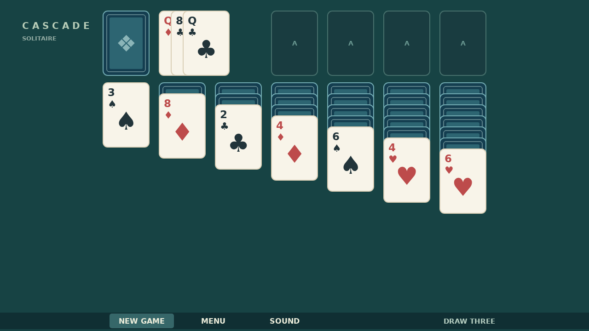

# Cascade

Cascade is a quiet game of Klondike on a deep green table. Turn three cards from the stock at a time, uncover the hidden cards in seven columns, and build four foundations from Ace to King.

Move cards by dragging them onto a matching column or foundation. A column builds downward in alternating colors, while an empty one waits for a King. Double-click a playable card when it can go straight home.

There is no clock to race. When the last card reaches a foundation, the completed decks leap into the air, bounce across the felt, and leave a painted trail of cards behind them.

